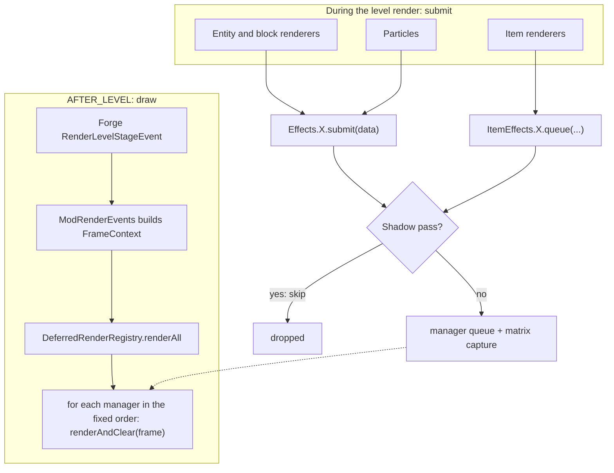
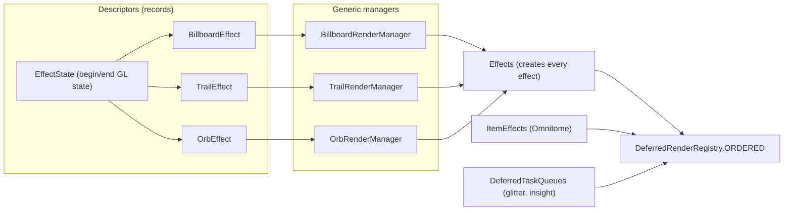
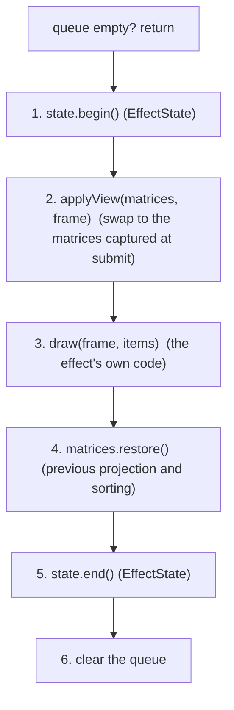
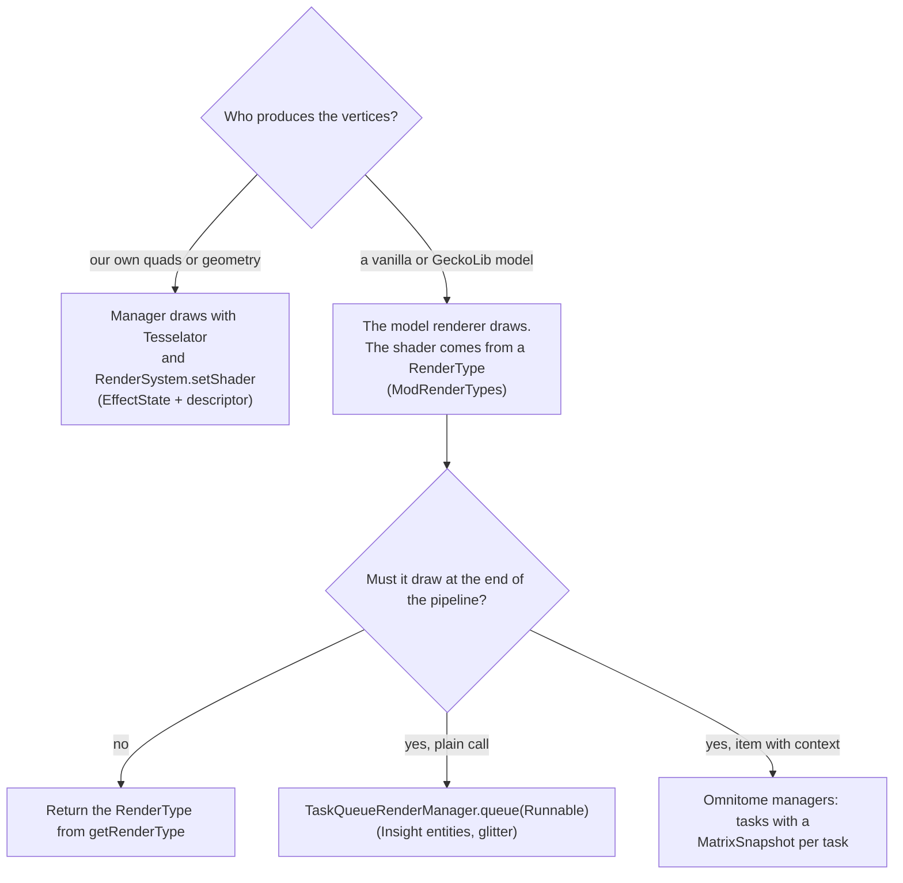

# Render architecture

How the deferred effects are organized. The reasons behind each choice are in `docs/adr/` (0001, 0003, 0004, 0007, 0009, 0011, 0012). This page is the map.

## The idea in one paragraph

Renderers, particles and item renderers never draw a custom effect immediately. They submit plain data to an effect (`Effects.SWIRL.submit(...)`). At the end of the level render (`AFTER_LEVEL`) one registry walks an ordered list of managers and each manager draws what was submitted and clears its queue. This keeps the effects compatible with shader packs, which redirect the vanilla pipeline.

## A frame



- The shadow pass guard is `RenderPassGuard.shouldSkipDeferred(...)` (ADR 0003). It runs at submit time, so a shadow pass never queues anything.
- The registry order is part of the behavior (ADR 0002). It is the list `ORDERED` in `DeferredRenderRegistry`.
- `SceneColorCopy` is invalidated at the start of every pass. The raymarchers that sample the scene share one copy (ADR 0009).

## Class hierarchy


Two families:

- **Queued managers** extend `QueuedRenderManager<T>`. They share one lifecycle (below) and only write their own `draw`.
- **Direct managers** implement `DeferredRenderManager` themselves. They are listed here with the reason, and whether the reason is a real blocker or only something the base class does not support yet.

| Manager | Why it is not queued | Real blocker? |
|---|---|---|
| `BloodBlobRenderManager` | It has no queue. It draws from `BloodBlobEmitters` every frame. | Yes |
| `BloodStainDecalRenderManager` | Its queue is a map keyed by id, so submitting the same id replaces the decal. | Yes, queue shape |
| `OrbRenderManager` | Each orb carries its own projection and the manager restores the event projection itself. The guard also depends on the item display context. | No: the base has no mode without captured matrices and only knows the guard without a context |
| `MiniBlobRenderManager` | It reads the event projection and camera and captures no matrices. It has no shadow pass guard on purpose. | No: same missing mode in the base |
| `OmnitomeBook`, `OmnitomeClip`, `OmnitomeVoid` | Matrices are captured per task (`MatrixSnapshot`) and the guard depends on the item display context. | No: same two gaps |

If the base grew an option to skip the matrix capture and an overridable guard, the orbs, the mini blob and the Omnitome managers could extend it too. That has not been done because it adds branches to the base for few users.

The staff orbs receive the charge of the held staff as `OrbCharge` (`StaffChargeClient.view()`, smoothed on the client) and the manager sets it as the uniforms `u_Charge` (0 to 1), `u_ChargeTime`, `u_Flash` (reaching full) and `u_Pulse` (each charge gained). `u_ChargeTime` is a clock that the client accumulates at a speed that grows with the charge (less for the blood orb, whose heartbeat sound follows the same clock): a shader that multiplied `u_Time` by a changing speed would jump in phase every time the speed changed.

Known leftover: `OrbRenderManager` still gives the event projection back with a hardcoded `VertexSorting.ORTHOGRAPHIC_Z`, while `DeferredMatrices` and the Omnitome managers restore the previous sorting.

## Where the instances and their configuration live



`Effects`, `ItemEffects` and `DeferredTaskQueues` are the only places that construct managers. Callers use them as `Effects.SWIRL.submit(...)` and never name a manager class.

## Lifecycle of a queued manager

Every `QueuedRenderManager` runs exactly this, in this order. Only step 3 is written per effect (a billboard with a camera view also overrides step 2).



`enqueue(item)` is the submit side: shadow pass guard, capture the projection and model view when the queue was empty (ADR 0004), add.

## Package map

```
client/render/
  deferred/
    DeferredRenderRegistry, DeferredMatrices, MatrixSnapshot, SceneColorCopy, DeferredTaskQueues
    api/    DeferredRenderManager, DeferredRenderObserver, FrameContext, EffectState
    base/   QueuedRenderManager, TaskQueueRenderManager
  effect/
    Effects, EffectStates
    BillboardRenderManager, TrailRenderManager, OrbRenderManager         generic
    BlackHole, BlackHoleEntity, RadialDistortion, MagicRing, NoiseSphere   queued, own geometry
    BloodBlob, MiniBlob, BloodStainDecal                                   direct
    api/    BillboardEffect, TrailEffect, OrbEffect,
            IBloodBlobEmitter, BloodBlobEmitters, ScreenSampledDraw
    data/   BillboardData, TrailData, OrbData, OrbCharge, RingData, SphereData, DistortionData,
            BlackHoleData, BlackHoleRenderData, DecalData, MiniBlob
  item/deferred/
    ItemEffects, ItemPassState, OmnitomeBook / OmnitomeClip / OmnitomeVoid managers
    api/    ItemDraw, VoidDraw
    data/   BookTask, ClipTask, VoidTask
  view/     ViewEffects

event/handlers/ModRenderEvents      the only Forge entry point: builds the FrameContext
client/shader/                      RenderPassGuard, ShaderTime, ModShaders, ShaderUtils
```

Rule of thumb: interfaces, descriptors and records go in `api/` or `data/`, implementations stay in the parent folder. Nothing under `effect/` or `deferred/` imports particle, block or Forge code.

## Two ways to apply a custom shader

A shader reaches the screen in one of two ways, depending on who produces the vertices. The deferral (when it is drawn) and the shader choice (how it is drawn) are separate decisions, and some effects use both.



- Billboards, trails, orbs, rings, spheres and the black holes are the first branch.
- Insight entities are the second branch twice: `getRenderType` returns `ModRenderTypes.getInsightDistortion` and `render` queues the whole model draw in `DeferredTaskQueues.INSIGHT` so it happens at the end of the pipeline.
- The Omnitome managers draw a GeckoLib model through `ModRenderTypes.getOmnitomeVoid` and `getEmergeClip`, deferred with one `MatrixSnapshot` per task.
- A `RenderType` has no `equals`, so `ModRenderTypes` creates each one once per texture with `Util.memoize`. Do the same for any new render type that takes a texture, or the `BufferSource` ends a batch on every call.

## When things are drawn

Order inside one frame of `GameRenderer.renderLevel`: the level, then the `AFTER_LEVEL` stage (the deferred pass), then the first person hand, and the GUI after all of that.

- Anything submitted while the level or the entities render is drawn in the same frame, at `AFTER_LEVEL`.
- The hand and the GUI render after `AFTER_LEVEL`. What they submit is drawn at the next frame's `AFTER_LEVEL`, one frame late and before the GUI of that frame is drawn over it.
- The effects that raymarch around an item (the staff orbs) work in view space and assume the hand: the pose of the item includes its display scale (1 in the hand, 0.6 on the ground, a few pixels in the GUI). `OrbRenderManager` takes that scale from the rotation, scales the quad with it and gives the shader a rotation divided by the scale squared, so the sphere follows the item. The shader inverts the matrix with `transpose`, which is only right for a pure rotation. In the hand the scale is 1 and nothing changes. The GUI is not supported (TECH_DEBT 30).
- That is why the hand book is replayed by `OmnitomeBookRenderManager` inside the pass (the void manager runs after it in the registry order), and why anything that only a deferred manager draws would disappear in the GUI. `OmnitomeVoidLayer` therefore draws its pages immediately, through `ModRenderTypes.getOmnitomeVoid`, when the context is the GUI, and queues them in every other context.

## Shader packs

- With a shader pack Iris moves the view bobbing, the hurt tilt and the nausea spin out of the projection and into the model view. A manager that rebuilds the view from the camera rotation must use `ViewEffects.applyCameraView` (ADR 0011).
- `event.getPoseStack()` at `AFTER_LEVEL` is the projection, not a view.
- Without a pack `ViewEffects` only applies the camera rotation, so vanilla and Iris without a pack behave as before.

## GL state hygiene

Managers run one after another in the same GL state, and a manager that has nothing queued returns without touching it, so a state left behind by one manager reaches whichever manager has work next.

- Set every piece of state an effect depends on in its `EffectState`, including the depth test. Do not rely on the state a previous manager left.
- Anything drawn through a `RenderType` ends with the depth test disabled, because vanilla turns it off when it clears the depth state of the render type and expects the next render type to turn it on again. The Insight queue and the Omnitome managers draw this way, so their `EffectState` or the code after them must turn it back on. The Insight queue did not, and the frenzied trails showed through walls whenever an Insight entity was visible (`TaskQueueRenderManager.DEFAULT_STATE` now restores it).
- `scripts/glprobe.ps1` shows these leaks: a manager whose exit state differs from its entry state is leaving something behind.

## Adding an effect

- **Another billboard, trail or orb:** one entry in `Effects` (a descriptor and its shader supplier), one line in `DeferredRenderRegistry.ORDERED` at the position it must draw, then submit with `Effects.NAME.submit(...)`. If it needs a new GL state, add an `EffectState` to `EffectStates`.
- **An effect with its own geometry:** a class that extends `QueuedRenderManager<YourData>`, a record in `effect/data`, an `EffectState`, an entry in `Effects` and in the registry.
- **Something that does not fit the shared lifecycle:** implement `DeferredRenderManager` directly and say why in the class name or the ADR.

## Checks before committing a render change

1. `./gradlew compileJava` (JDK 17).
2. `scripts/check-gl-calls.ps1`. A moved call is expected to show up as a difference. Compare the sequence before accepting it with `-Accept`, and use `-Retire` when a file is merged on purpose.
3. `scripts/run-testworld.ps1 -GlProbe`, then `scripts/glprobe.ps1 -Name vanilla` (see `docs/TESTING.md`).
4. Look at it in game with and without a shader pack. The probe only sees GL state, not what it looks like.

The OpenGL state calls of an effect stay verbatim and in the same order unless the change is a deliberate behavior change in its own commit (ADR 0007).
