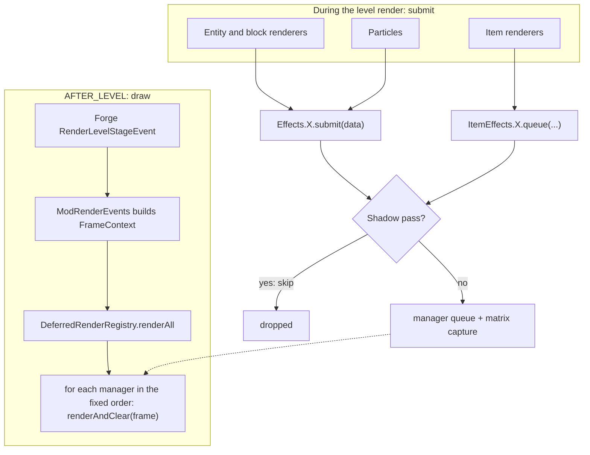
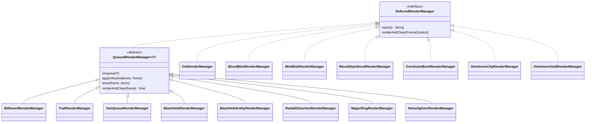
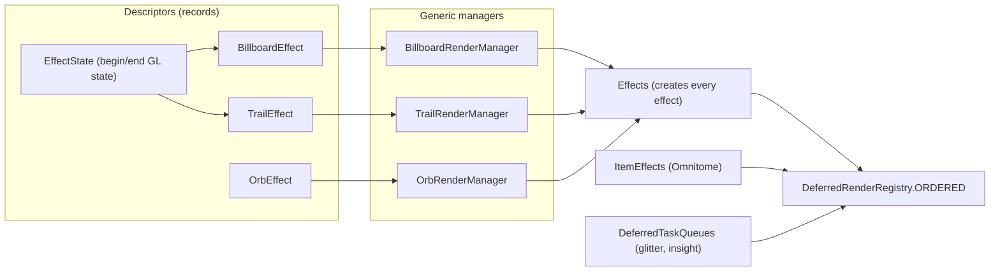
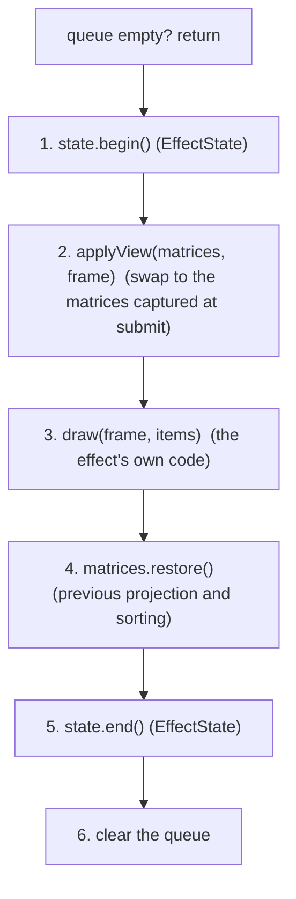

# Render architecture

How the deferred effects are organized. The reasons behind each choice are in `docs/adr/` (0001, 0003, 0004, 0007, 0009, 0011, 0012). This page is the map.

## The idea in one paragraph

Renderers, particles and item renderers never draw a custom effect immediately. They submit plain data to an effect (`Effects.SWIRL.submit(...)`). At the end of the level render (`AFTER_LEVEL`) one registry walks an ordered list of managers and each manager draws what was submitted and clears its queue. This keeps the effects compatible with shader packs, which redirect the vanilla pipeline.

## A frame



- The shadow pass guard is `RenderPassGuard.shouldSkipDeferred(...)` (ADR 0003). It runs at submit time, so a shadow pass never queues anything.
- The registry order is part of the behavior (ADR 0002). It is the list `ORDERED` in `DeferredRenderRegistry`.
- `SceneColorCopy` is invalidated at the start of every pass. The raymarchers that sample the scene share one copy (ADR 0009).

## Class hierarchy



Two families:

- **Queued managers** extend `QueuedRenderManager<T>`. They share one lifecycle (below) and only write their own `draw`.
- **Direct managers** implement `DeferredRenderManager` themselves because their matrix or scene handling does not fit the shared lifecycle (the orbs use a projection per orb, the blobs read the event matrices, the decal keys its queue by id, Omnitome swaps matrices per task).

## Where the instances and their configuration live



`Effects`, `ItemEffects` and `DeferredTaskQueues` are the only places that construct managers. Callers use them as `Effects.SWIRL.submit(...)` and never name a manager class.

## Lifecycle of a queued manager

Every `QueuedRenderManager` runs exactly this, in this order. Only step 3 is written per effect (a billboard with a camera view also overrides step 2).



`enqueue(item)` is the submit side: shadow pass guard, capture the projection and model view when the queue was empty (ADR 0004), add.

## Package map

```
client/render/
  deferred/
    DeferredRenderRegistry, DeferredMatrices, MatrixSnapshot, SceneColorCopy, DeferredTaskQueues
    api/    DeferredRenderManager, DeferredRenderObserver, FrameContext, EffectState
    base/   QueuedRenderManager, TaskQueueRenderManager
  effect/
    Effects, EffectStates
    BillboardRenderManager, TrailRenderManager, OrbRenderManager         generic
    BlackHole, BlackHoleEntity, RadialDistortion, MagicRing, NoiseSphere   queued, own geometry
    BloodBlob, MiniBlob, BloodStainDecal                                   direct
    api/    BillboardEffect, TrailEffect, OrbEffect,
            IBloodBlobEmitter, BloodBlobEmitters, ScreenSampledDraw
    data/   BillboardData, TrailData, OrbData, RingData, SphereData, DistortionData,
            BlackHoleData, BlackHoleRenderData, DecalData, MiniBlob
  item/deferred/
    ItemEffects, ItemPassState, OmnitomeBook / OmnitomeClip / OmnitomeVoid managers
    api/    ItemDraw, VoidDraw
    data/   BookTask, ClipTask, VoidTask
  view/     ViewEffects

event/handlers/ModRenderEvents      the only Forge entry point: builds the FrameContext
client/shader/                      RenderPassGuard, ShaderTime, ModShaders, ShaderUtils
```

Rule of thumb: interfaces, descriptors and records go in `api/` or `data/`, implementations stay in the parent folder. Nothing under `effect/` or `deferred/` imports particle, block or Forge code.

## Shader packs

- With a shader pack Iris moves the view bobbing, the hurt tilt and the nausea spin out of the projection and into the model view. A manager that rebuilds the view from the camera rotation must use `ViewEffects.applyCameraView` (ADR 0011).
- `event.getPoseStack()` at `AFTER_LEVEL` is the projection, not a view.
- Without a pack `ViewEffects` only applies the camera rotation, so vanilla and Iris without a pack behave as before.

## Adding an effect

- **Another billboard, trail or orb:** one entry in `Effects` (a descriptor and its shader supplier), one line in `DeferredRenderRegistry.ORDERED` at the position it must draw, then submit with `Effects.NAME.submit(...)`. If it needs a new GL state, add an `EffectState` to `EffectStates`.
- **An effect with its own geometry:** a class that extends `QueuedRenderManager<YourData>`, a record in `effect/data`, an `EffectState`, an entry in `Effects` and in the registry.
- **Something that does not fit the shared lifecycle:** implement `DeferredRenderManager` directly and say why in the class name or the ADR.

## Checks before committing a render change

1. `./gradlew compileJava` (JDK 17).
2. `scripts/check-gl-calls.ps1`. A moved call is expected to show up as a difference. Compare the sequence before accepting it with `-Accept`, and use `-Retire` when a file is merged on purpose.
3. `scripts/run-testworld.ps1 -GlProbe`, then `scripts/glprobe.ps1 -Name vanilla` (see `docs/TESTING.md`).
4. Look at it in game with and without a shader pack. The probe only sees GL state, not what it looks like.

The OpenGL state calls of an effect stay verbatim and in the same order unless the change is a deliberate behavior change in its own commit (ADR 0007).
